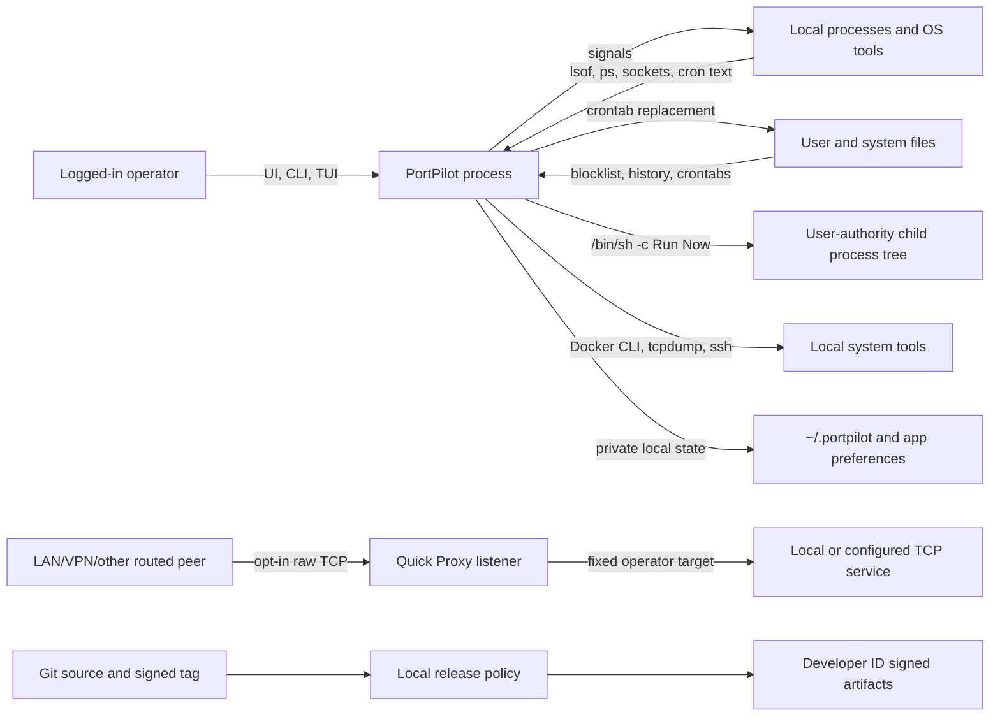

# PortPilot Daybreak security audit — 2026-10-29

## Outcome

This source-grounded review confirmed four security risks. None is a remote
code-execution or privilege-escalation vulnerability under the stated
single-user macOS model. Two can nevertheless defeat PortPilot's core promises:
Quick Proxy accepted an all-address policy that the product said never to use,
and cron discovery failures were rendered as a successful empty/partial view.

The operator approved all four findings. The remediations and follow-up review
fixes are merged into `main` at commit
`a719754c079df89f0507244e3c78be4b084a7340` and covered by source-level
regressions. This does not establish a notarized or published release,
installed-app verification, live-LAN validation, or Windows parity.

| ID | Finding | Severity | Confidence | Source status |
| --- | --- | --- | --- | --- |
| DB-01 | Quick Proxy accepted `/0` and exposed the relay across interfaces | Medium; high impact for a sensitive target | High | Remediated |
| DB-02 | Cron discovery failures replaced the last good view with empty/partial state | Medium | High | Remediated |
| DB-03 | Alert-list read failures failed open and were cached as empty | Low | High | Remediated |
| DB-04 | Release policy accepted Developer ID artifacts without hardened runtime | Medium release-integrity risk | High | Remediated |
| DB-05 | Failed connection enrichment still looked current/clean in the main UI | Medium | High | Remediated after independent review |
| DB-06 | Contradictory cron filters returned a successful empty result | Low | High | Remediated after independent review |
| DB-07 | Release policy did not reject hardened-runtime exception entitlements | Low | High policy confidence; low present exposure | Remediated after independent review |

### Approved remediation summary

- DB-01: shared proxy-policy validation rejects IPv4 and IPv6 `/0`; `/32` and
  `/128` remain accepted.
- DB-02: discovery returns a typed completeness snapshot, distinguishes a
  confirmed absent personal crontab from failure, tracks partial system reads,
  and makes app/CLI/TUI retain or refuse incomplete data instead of claiming
  empty success.
- DB-03: alert-list reads distinguish missing from unreadable/corrupt. A read
  failure aborts connection enrichment, so monitoring becomes degraded and its
  learning baseline does not advance from a snapshot missing alert-list policy.
- DB-04: generated app settings enable hardened runtime and release policy
  requires the runtime flag on every code-directory line reported for the app,
  CLI, and TUI.
- DB-05: the main connection model publishes failure and last-success state;
  the traffic strip and inspector distinguish pending, stale, and successful
  empty snapshots while keeping last-good observations.
- DB-06: the library returns an incomplete snapshot and the CLI rejects
  `--user-only --system-only` before discovery.
- DB-07: release policy inspects every architecture's signed entitlements and
  rejects known hardened-runtime exceptions for the app, CLI, and TUI.

## Audit brief

> Treat process/socket metadata, cron text, persisted security state, LAN
> clients, build products, and command results as untrusted at their trust
> boundaries. Trace every externally reachable listener and every local effect
> from entry point to authorization check and sink. Confirm a finding only when
> source establishes prerequisites, a reachable path, and concrete impact.
> Prefer safe local fixtures over live signals, listeners, credentials, or
> third-party systems. Do not implement fixes until the operator approves the
> findings.

## Scope and assumptions

- Current target: macOS app, menu-bar app, CLI/TUI, and shared
  `Sources/PortManagerLib`. Windows is planned/partial and was not claimed as
  parity.
- Runtime authority: the logged-in OS user. There is intentionally no separate
  PortPilot account or application-login boundary for local actions.
- Network: monitoring itself is local. App Quick Proxy is loopback-only by
  default; LAN reachability is an explicit opt-in. Source CIDRs are admission
  filters, not client authentication, encryption, or proof of a physical LAN.
- Out of scope: internet/router exposure configured outside PortPilot,
  production credentials, Apple notarization, third-party services, and live
  destructive effects.
- The working tree already contained uncommitted menu-bar refresh work. This
  audit preserved it and assessed the current source snapshot.

## Trust boundaries and data flow

The only inbound runtime network surface found is app Quick Proxy. No network
endpoint exposes kill, freeze, resume, Guard, Docker, or cron controls.

## Entry points, authorization, persistence, and effects

| Area | Entry or boundary | Authorization/control | Persistence or effect |
| --- | --- | --- | --- |
| macOS app/menu bar | Local clicks and preferences | Logged-in OS user | Signals processes, controls Guard, edits/runs cron, starts proxy/capture |
| CLI/TUI | Local argv, keyboard input, terminal output | Shell user; explicit confirmations on destructive bulk actions | Signals processes, edits/runs cron, launches OpenSSH SOCKS |
| Quick Proxy | TCP listener | Loopback by default; opt-in source CIDRs | Raw bidirectional relay to fixed target; no proxy login or TLS |
| Discovery | `lsof`, `ps`, socket tables, crontab/system files | Read permissions of current user | Populates process, connection, cron, and threat views |
| Cron Run Now | Selected discovered command | Deliberate local operator action | `/bin/sh -c` with user authority; 256 KiB retained output; one-hour deadline |
| Process control | Captured PID plus incarnation identity | Fresh identity recheck before signals/escalation | TERM/KILL/STOP/CONT; receipts distinguish unresolved outcomes |
| Alert list | `~/.portpilot/blocklist.txt` | Local file ownership; advisory cross-process edit lock | Detection annotation only, not firewall enforcement |
| Security state | `~/.portpilot`, app preferences | 0700 owned directory and 0600 sensitive files where implemented | Threat history, alert list, bounded run metadata, settings |
| Release | Signed main commit/tag and local artifacts | Git signature plus Developer ID certificate checks | Offline zip handoff; no publication or notarization |

No tracked private key, credential file, or hard-coded credential pattern was
found. Cron commands can contain secrets and threat history can contain endpoint
metadata; file permissions reduce cross-account disclosure but are not
encryption. The audit did not open Keychain or any credential store.

## Confirmed findings

The evidence paths below describe the vulnerable pre-fix flow. The approved
source remediation status is summarized above; the attack narratives are kept
for review provenance.

### DB-01 — Quick Proxy accepts forbidden all-address `/0` policies

**Original vulnerable code path (pre-remediation)**

- `Sources/PortManagerLib/TCPProxyManager.swift:12-20` accepts every nonempty
  list whose entries parse as CIDRs.
- `Sources/PortManagerLib/TCPProxyManager.swift:46-60` accepts prefix length
  zero for IPv4 and IPv6; its zero-bit comparison consequently matches every
  address.
- `Sources/PortPilot/ConfigurationPanel.swift:631-666,676-705` warns "never
  /0" but treats that policy as valid, enables Start Proxy, and passes it to
  the view model.
- `Sources/PortManagerLib/TCPProxyManager.swift:159-186` validates the policy
  and creates a wildcard listener for custom CIDRs.
- `Sources/PortManagerLib/TCPProxyManager.swift:276-305` admits any matching
  client and opens the outbound connection to the configured target.

**Attacker prerequisites**

The operator must enable selected network clients and enter `0.0.0.0/0` or
`::/0`. The attacker must be able to route to the Mac's listen port through a
LAN, VPN, another interface, or separately configured port forwarding.

**Reachable attack path**

`/0` passes UI/library validation -> custom policy creates an all-interface
listener -> zero-prefix matching permits every source address -> the peer gets
a raw TCP relay to the configured target.

**Concrete impact**

A loopback-only database, dashboard, development server, or admin service can
become remotely reachable without proxy-level authentication or encryption.
Target-service authentication/TLS reduces the impact; an unauthenticated target
makes the impact high.

**Confidence and assumptions**

High confidence. Reachability is established directly by the shared validator,
UI gate, listener construction, and admission path. Exploitation still requires
the explicit LAN opt-in and a routed peer.

**Safe local reproduction/regression**

Do not open a listener. A pre-fix pure reproduction asserted that
`ProxyAccessPolicy.allowedCIDRs(["0.0.0.0/0"])` and `(["::/0"])` validate and
permit documentation-only addresses such as `203.0.113.77` and `2001:db8::77`.
The fixed regression should require both validations to throw while `/32` and
`/128` remain accepted.

**Smallest correct remediation**

Reject prefix length zero in the shared `ProxyAccessPolicy.validate()` path and
add IPv4/IPv6 tests. Do not change alert-list `/0` semantics; that list annotates
observations and is a separate policy. If physical-LAN-only binding becomes a
hard requirement, add an explicit interface/local-address binding rather than
claiming CIDRs provide it.

**Current remediation evidence:** `TCPProxyManager.swift` rejects a parsed
prefix length of zero in shared policy validation. `BlocklistTests.swift`
regresses rejection of IPv4/IPv6 `/0` and acceptance of `/32` and `/128`.

### DB-02 — Cron discovery failures become a successful empty/partial snapshot

**Original vulnerable code path (pre-remediation)**

- `Sources/PortManagerLib/PortManager+CronDiscovery.swift:12-29` returns only
  `[CronjobEntry]`, with no completeness or error state.
- `Sources/PortManagerLib/PortManager+CronDiscovery.swift:33-38` reads the user
  crontab through `runCommandQuiet`.
- `Sources/PortManagerLib/PortManager.swift:1457-1458` returns subprocess output
  while discarding timeout, truncation, launch failure, and nonzero status.
- `Sources/PortManagerLib/PortManager+CronDiscovery.swift:42-84` silently skips
  unreadable system sources via `try?`.
- `Sources/PortPilot/Stores/CronjobController.swift:27-50` replaces the last
  snapshot with the returned array and exposes no failure state.
- `Sources/PortPilot/CronjobListPanel.swift:28-29,59-71` renders zero/"No
  Cronjobs Found"; `Sources/PortPilot/MenuBarDropdownView.swift:187-193`
  describes the result as the latest crontab read.

**Attacker prerequisites**

A local actor must induce command failure, timeout, truncation, or an unreadable
cron source. The same behavior occurs from ordinary permission, storage, or tool
failure without an attacker.

**Reachable attack path**

Scheduled persistence exists -> one or more discovery sources fail -> errors or
missing content parse as no entries -> the controller overwrites the last good
snapshot -> the UI reports no jobs or an incomplete list.

**Concrete impact**

Active cron persistence can disappear from PortPilot's security view. The
operator also loses the visible row needed to inspect, pause, or resume it.

**Confidence and assumptions**

High confidence for failure-state collapse. Impact assumes PortPilot's cron view
is relied upon for persistence visibility. A confirmed absent personal crontab
is a legitimate successful empty state and must remain distinct from failure.

**Safe local reproduction/regression**

Inject synthetic command results for launch failure, timeout, truncation,
nonzero status, and an unreadable existing system source. Seed a last-known-good
entry, refresh, and assert that the entry remains visible, discovery is marked
degraded, and the empty-state UI is not shown. Separately test the normal
"no personal crontab" result as successful empty. Do not modify the operator's
real crontab.

**Smallest correct remediation**

Replace quiet discovery with a checked, typed `CronDiscoverySnapshot` carrying
entries, completeness, and per-source errors. Distinguish the tool's confirmed
"no crontab" result from other nonzero exits. Retain the last successful list
and publish a degraded state when any expected source cannot be read.

**Current remediation evidence:** `PortManager+CronDiscovery.swift` returns a
typed snapshot from checked command results, distinguishes confirmed absence
from command failure, and records system-source errors. App, CLI, and TUI paths
require a complete snapshot; the app controller retains the last successful
jobs when refresh degrades. `CronPersistenceConcurrencyTests.swift` covers the
failure and legitimate-empty boundaries. Retained stale rows are inspect-only:
the UI disables effects and `CronjobController` independently refuses Run Now
and schedule edits until a complete refresh; stopping a tracked active run
remains available without the stale command-matching sweep.

### DB-03 — Alert-list read failures fail open and are cached as empty

**Original vulnerable code path (pre-remediation)**

- `Sources/PortManagerLib/BlocklistStore.swift:65-68,120-125` turns every read
  error into an empty public entry list.
- `Sources/PortManagerLib/PortManager+Connections.swift:347-371` independently
  turns disk-read failure into an empty list and caches it for 60 seconds.
- `Sources/PortManagerLib/PortManager+Connections.swift:374-382` then reports no
  match for every connection.
- `Sources/PortManagerLib/ThreatDetector.swift:59-61` relies on that match for
  the critical alert-list signal.
- `Sources/PortPilot/Stores/ThreatMonitorStore.swift:164-175` treats the
  assessment as successful and advances learning.
- `Sources/PortKillerCLI/BlocklistCommand.swift:35-44` reports the same failure
  as "Blocklist is empty."

**Attacker prerequisites**

The current user or root must make the alert-list file unreadable, or a storage
or permission failure must occur. A remote network peer alone cannot trigger
this path.

**Reachable attack path**

A nonempty alert list becomes unreadable -> readers return and cache `[]` ->
listed remotes no longer receive the alert-list signal -> monitoring treats the
connection snapshot as complete and the CLI claims the list is empty.

**Concrete impact**

Missed annotations/alerts and false operator assurance. This is not a firewall
bypass because the alert list never blocks traffic.

**Confidence and assumptions**

High confidence in fail-open behavior; low severity under the single-user model
because a malicious same-user process could also change the file directly.

**Safe local reproduction/regression**

Use a temporary alert-list path: write a synthetic entry, confirm it loads, make
the file unreadable, and assert a typed error rather than empty state. At the
monitor boundary, inject a last-known-good list followed by a read failure and
assert that matching remains active while monitoring becomes degraded. A truly
missing file must remain valid empty.

**Smallest correct remediation**

Use one throwing/typed alert-list reader for the store, detector, and CLI.
Distinguish missing from unreadable/corrupt, preserve the last-known-good list
on error, and propagate degraded state instead of caching empty.

**Current remediation evidence:** `BlocklistStore.entries()` now throws for
unreadable or corrupt policy while preserving missing-file-as-empty semantics.
Connection enrichment loads policy once and aborts on failure, which drives the
existing degraded monitor path without advancing learning; the CLI reports a
nonzero failure. `ThreatDetectorTests.swift` regresses corrupt versus missing
policy behavior.

### DB-04 — Release policy accepts artifacts without hardened runtime

**Original vulnerable code path (pre-remediation)**

- `project.yml:33-45`, specifically line 40, sets
  `ENABLE_HARDENED_RUNTIME: NO` for the app target.
- `PortPilot.xcodeproj/project.pbxproj:658-673`, specifically line 664, carries
  the same Release setting.
- `scripts/release_policy.sh:34-43` verifies Developer ID identity and signature
  integrity but does not require the hardened-runtime code-signing flag.
- `scripts/release_policy.sh:51-63` accepts the app, CLI, and TUI on that basis.
- `scripts/release_scripts.test.cjs` covers unsigned, ad-hoc, development,
  wrong-team, and damaged signatures, but not a valid Developer ID signature
  missing hardened runtime.

**Attacker prerequisites**

Local code execution plus an opportunity to inject into or tamper with the
running process or its launch environment. There is no remote-only path and no
elevation beyond the logged-in user.

**Reachable attack path**

An artifact is Developer ID signed without hardened runtime -> release policy
accepts it -> the artifact is handed off as the trusted security utility without
runtime code-injection/library-validation protections.

**Concrete impact**

Reduced integrity of PortPilot's observations and user-authority effects.
Injected code could falsify displayed state or invoke process, cron, or proxy
actions. This is defense-in-depth, not a same-user privilege escalation.

**Confidence and assumptions**

High confidence that policy permits the state. The current handoff explicitly
does not claim notarization, so this is not a false-notarization finding.

**Safe local reproduction/regression**

Extend the release-policy mocks with a valid Developer ID signature whose
`codesign -d --verbose=4` flags omit `runtime`; assert rejection for app, CLI,
and TUI. Assert the generated Release app setting is `YES`. No identity,
credential, or Apple service is required.

**Smallest correct remediation**

Enable hardened runtime for Release in `project.yml`, regenerate the project,
sign CLI/TUI with runtime options, and make `release_policy.sh` verify the
runtime flag on every executable before packaging. Avoid broad exception
entitlements unless a demonstrated feature requires one.

**Current remediation evidence:** `project.yml` and the generated Xcode project
enable hardened runtime. `release_policy.sh` verifies all architectures, uses
`lipo` to enumerate slices, and requires the runtime flag per architecture for
the app, CLI, and TUI. It also rejects known exception entitlements per slice.
`release_scripts.test.cjs` rejects a missing runtime flag for each artifact, a
universal artifact with one non-runtime slice, and exception entitlements on
each artifact.

### DB-05 — Failed connection enrichment still looked current or clean

**Original vulnerable code path (pre-remediation)**

- `Sources/PortPilot/PortViewModel.swift`, `refreshAllConnections()`, retained
  cached connections on failure but exposed no published failure or freshness.
- `Sources/PortPilot/Liquid/MainTrafficStrip.swift`, the Connections tile,
  rendered the cached count without a stale marker.
- `Sources/PortPilot/Liquid/InspectorComponents.swift`, `connectionsCard(for:)`,
  rendered the initial empty array as "No established connections" even when
  no connection refresh had succeeded.

**Attacker prerequisites:** a local actor must cause connection discovery or
alert-list enrichment to fail. Ordinary command, permission, storage, or corrupt
local-policy failures reach the same path; a remote peer alone does not.

**Reachable attack path:** enrichment fails -> the model retains its initial or
last-good array without publishing failure -> UI renders that array as current
or successfully empty.

**Concrete impact:** the main window can provide false-clean or stale assurance
even though threat monitoring correctly degraded.

**Confidence and assumptions:** high. This assumes the main traffic strip or
process inspector is used as a current connection observation.

**Safe local reproduction/regression:** the native regression uses an isolated
home, completes one checked connection refresh, writes invalid UTF-8 to its
synthetic `.portpilot/blocklist.txt`, and verifies failure state, unchanged
last-success time, retained observations, and recovery after removing the file.

**Smallest correct remediation:** publish error and last-success state at the
model boundary and make every affected consumer distinguish pending,
stale/last-good, and successful-empty data. Current evidence is in
`PortViewModel.swift`, `MainTrafficStrip.swift`, `InspectorComponents.swift`,
`MenuBarController.swift`, and `LiveMetricsHistory.swift`. The unified status
reports degraded, the menubar tooltip gives last-success context, and metric
history does not append stale connection samples. Unified alert precedence uses
threat findings only while their monitoring status is current; fresh critical
evidence can still outrank an unrelated degraded source.

### DB-06 — Contradictory cron filters returned successful empty

**Original vulnerable code path (pre-remediation)**

- `Sources/PortManagerLib/PortManager+CronDiscovery.swift`,
  `getCronjobSnapshot(userOnly:systemOnly:)`, skipped both sources when both
  Boolean filters were true.
- `Sources/PortKillerCLI/CLI.swift`, `Cronjobs.run()`, accepted both flags and
  printed "No cronjobs found" with exit status zero.

**Attacker prerequisites:** local CLI access or an automation/configuration
mistake passing both flags. No remote path exists.

**Reachable attack path:** invoke both exclusive filters -> scan neither source
-> receive a successful empty result.

**Concrete impact:** scripts or operators can mistake an invalid query for proof
that no scheduled persistence exists.

**Confidence and assumptions:** high; the pre-fix command reproduced locally
with exit zero.

**Safe local reproduction/regression:** the unit test asks the library for both
filters and requires an incomplete snapshot. The built CLI now exits 64 with a
validation error before reading any crontab.

**Smallest correct remediation:** reject the combination at the CLI boundary
and fail closed at the shared library boundary. Current evidence is in
`PortManager+CronDiscovery.swift:54-60`, `CLI.swift:725-735`, and
`CronPersistenceConcurrencyTests.swift`.

### DB-07 — Runtime exception entitlements bypassed release intent

**Original vulnerable code path (pre-remediation)**

- `scripts/release_policy.sh`, `verify_release_artifact()`, verified Developer
  ID integrity and the runtime flag for every architecture but never inspected
  signed entitlements.
- `Sources/PortPilot/PortPilot.entitlements` is currently empty, so this was a
  release-policy drift risk rather than evidence of a shipped exception.

**Attacker prerequisites:** control of or misconfiguration in the local build
and signing pipeline sufficient to produce a valid team-signed artifact with a
hardened-runtime exception.

**Reachable attack path:** sign with `runtime` plus an exception such as
`disable-library-validation` -> prior release policy accepted the artifact.

**Concrete impact:** weakened library/code-injection defense in a trusted local
security utility. This is defense in depth, not a remote-only privilege gain.

**Confidence and assumptions:** high for the old policy behavior; low present
exposure because the checked-in entitlement file contains no exception.

**Safe local reproduction/regression:** mocked per-architecture `codesign`
metadata returns `runtime` plus an exception entitlement; packaging must fail
for the app, CLI, and TUI without using a signing identity or Apple service.

**Smallest correct remediation:** extract signed entitlements per architecture
and reject known hardened-runtime exceptions unless a future audited policy
explicitly allowlists one. Current evidence is in `release_policy.sh:52-67` and
`release_scripts.test.cjs`.

## Rejected findings and residual risks

- **Terminal control characters:** human-readable CLI/TUI sinks do not
  consistently normalize C0/C1 controls, especially for cron text. Under the
  current single-user model, changing those sources already requires the same
  user or root; macOS `ps`/`lsof` also render ordinary process control bytes
  visibly. Treat output normalization as defense-in-depth before Linux/Windows,
  not a confirmed current boundary-crossing vulnerability.
- **Shell injection:** cron Run Now deliberately executes the operator-selected
  crontab command through `/bin/sh -c`. No remote/untrusted path into that sink
  was found. Output and runtime are bounded.
- **PID reuse:** process actions capture an incarnation identity and recheck it
  before signals and escalation. The final validation-to-signal race remains a
  documented user-space limitation, not a newly demonstrated exploit.
- **Proxy login/TLS:** Quick Proxy intentionally provides neither. This is
  disclosed and safe only when the target retains its own auth/TLS and the
  source policy is narrow.
- **Strict physical-LAN confinement:** custom policies listen across interfaces;
  CIDR matching cannot prove a packet arrived from a physical LAN. The product
  discloses this limitation.
- **Threat-history persistence race:** the apparent snapshot-write ordering
  issue is not currently reachable because production records originate from a
  serialized monitor tick and `clear()` has no source caller.
- **Cron edit races:** checked reads, a shared edit lock, duplicate selection,
  conflict reread, private temporary files, and fail-closed writes are present.
  An independent editor can still race after comparison; that residual is
  documented and is not an atomic crontab CAS.

## Local verification

- `swift test --disable-automatic-resolution --skip-update`: 192 tests passed.
- `swift build --product portpilot --disable-automatic-resolution --skip-update`:
  passed.
- macOS app Xcode target, Debug arm64, signing disabled and isolated build
  directories: passed.
- `node --test scripts/release_scripts.test.cjs`: 37 tests passed.
- `python3 scripts/test_menubar_refresh.py`: 48 native refresh checks and 6
  discovery-failure checks passed with Guard disarmed and threat polling off.
- `plutil -lint PortPilot.xcodeproj/project.pbxproj`: passed.
- `git -c core.whitespace=cr-at-eol diff --check`: passed.
- Two independent follow-up reviewers rechecked the remediations. One found
  DB-05, DB-06, and the retained-cron-list visibility gap; the other found
  DB-07 and confirmed the per-architecture DB-04 gate. All substantiated gaps
  were remediated and revalidated before this report was closed.

These are source/build results, not an installed-app, live-LAN, Windows,
notarization, or production-safety claim. No product proxy or non-loopback
listener was opened; the native regression used only ephemeral loopback
fixtures. No real process was signaled, no real crontab was changed, no
credential store was accessed, and no external system was contacted.

## Documentation and subdomain status

Domain-suffix matching is present and covered by
`Tests/PortPilotTests/BlocklistTests.swift:62-76`, including leading-dot,
subdomain-boundary, case, and trailing-dot cases. The repository now includes
a wiki-ready `docs/wiki/Security-Measures.md` page linked from README. It states
the current protections and their limits; no wiki publication harness exists.
The published GitHub wiki was not queried or changed because this assessment
prohibited third-party access.
