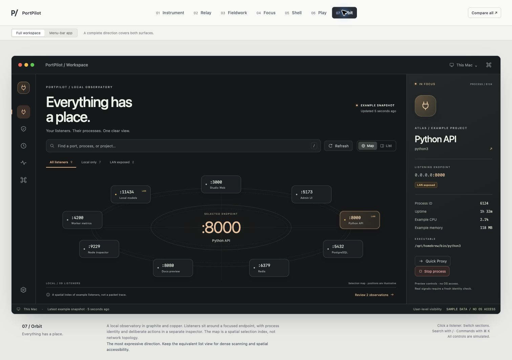
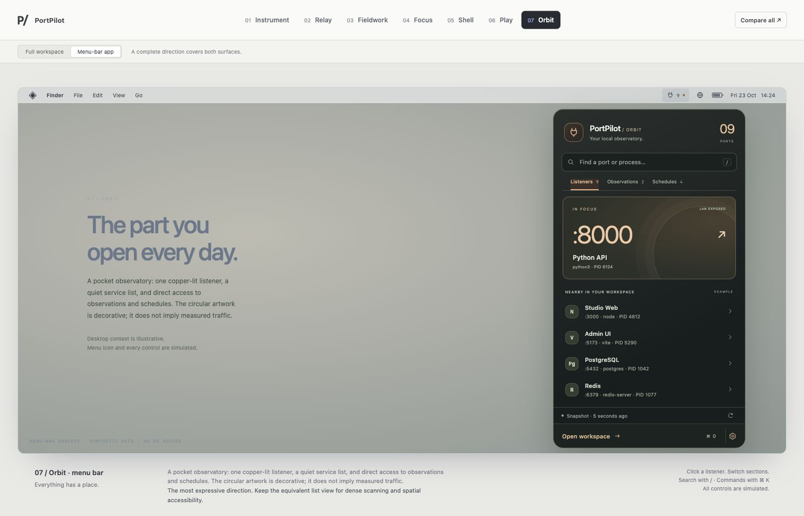
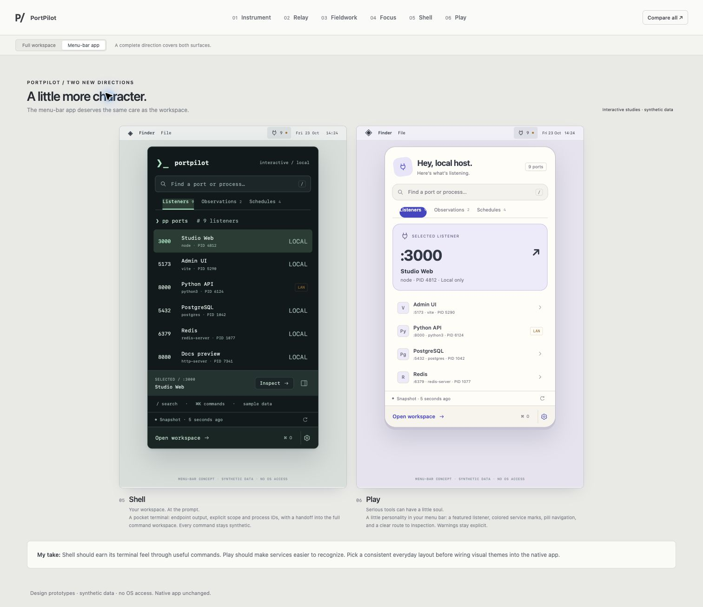
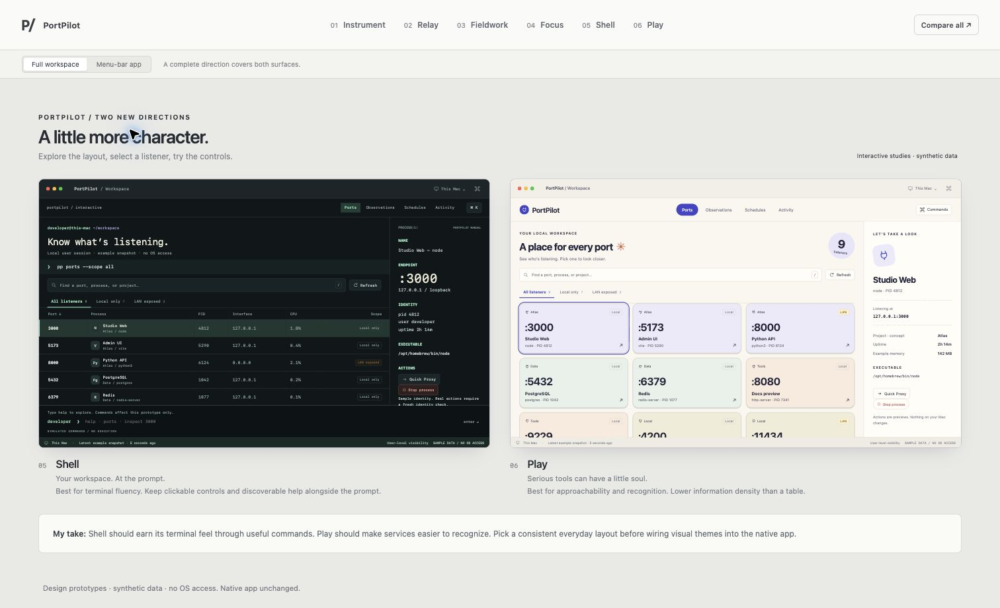
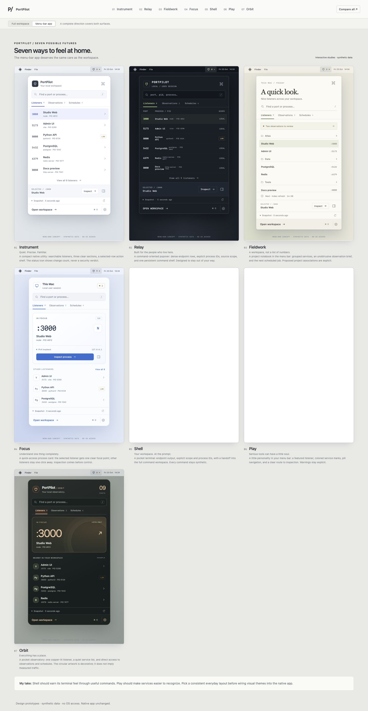
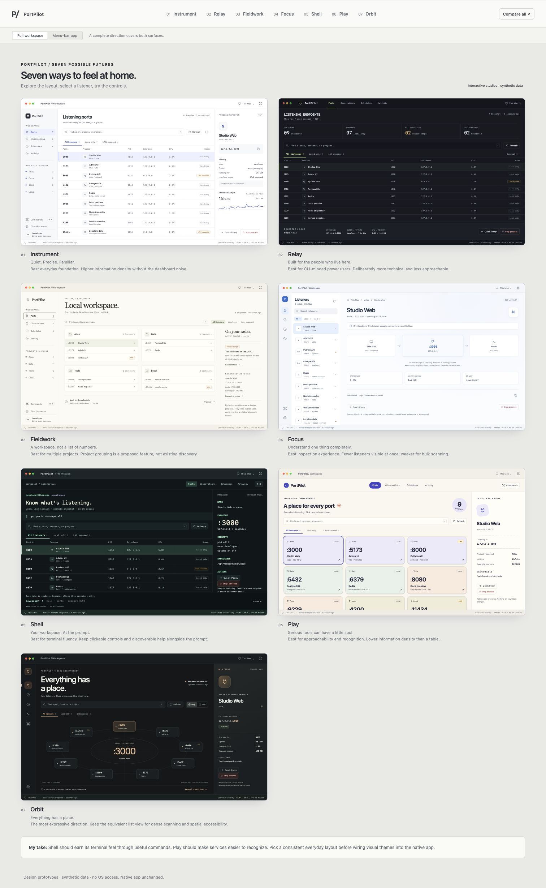

# PortPilot: seven interface directions

**07 Orbit** completes the set: graphite and copper, a spatial listener index,
an equivalent list view, and a matching pocket observatory in the menu bar.

All seven directions are now implemented as native SwiftUI compositions in
`DesignWorkspace.swift` and `MenuBarDropdownView.swift`. These browser studies
remain synthetic references. Native Fieldwork groups observed repositories and
directories; native Shell accepts navigation commands only; native Orbit shows
at most nine map nodes with a full list alternative. No simulated LAN binding or
sample metrics are inserted into the native app. Installation and live acceptance
are separate from source/build verification.

New: **05 Shell** adds a terminal workspace, manual-page inspector, and a fixed
prototype command prompt. **06 Play** adds tactile service tiles, soft project
colors, and a friendly inspector. Both include matching menu-bar apps.
Compare the new pair with `index.html?compare=1&set=new`; use the surface switch
for their popovers. Compare all includes all seven directions.

Shell accepts `help`, `ports` / `ls`, `find <text>`, `scope all|local|lan`,
`inspect <port>`, `stop <port>`, `proxy <port>`, `schedules`, and `clear`.
These select synthetic UI states only. No arbitrary command execution exists.

Open [the prototype](index.html), then choose **Compare all**. It works directly
from disk, without a build step, dependencies, fonts, analytics, or external
resources. All process/connection/cron data is synthetic. No control is connected
to the operating system. The installed app and its preferences are untouched.

Each direction includes **both a full workspace and a menu-bar app**. Use the
surface switch directly below the concept tabs; Compare all follows that choice.
The menu-bar studies include status capsules, search, listener selection,
observations, upcoming schedules, and a handoff into the full inspector.

| Direction | Structural change | Good for | Main tradeoff |
| --- | --- | --- | --- |
| 01 Instrument | Persistent table + right inspector; quiet macOS vocabulary | Everyday scanning and precise control | Less distinctive; table favors desktop widths |
| 02 Relay | Horizontal navigation, dense monospace grid, bottom selection tray | Power users, keyboard-driven work | Technical language and small text are less approachable |
| 03 Fieldwork | Project groups, editorial hierarchy, an observation brief | Multiple development projects | Reliable project assignment must be designed and implemented |
| 04 Focus | Narrow navigation rail, master list, process relationship canvas | Understanding a single listener before acting | Lower scanning density; weaker for comparing many processes |
| 05 Shell | Command output, manual-page inspector, editable preview prompt | Terminal fluency and explicit control | Needs visible help and equivalent clickable controls |
| 06 Play | Tactile service tiles and a friendly inspector | Recognition and approachability | Lower scanning density than a table |
| 07 Orbit | Spatial listener selection and a separate inspector | Orientation and focused inspection | Keep a full list for dense scans and narrow windows |

The native directions share one model, one set of effect handlers, and the same
security invariants. Layouts change the way you reach information; they do not
change process authority, proxy policy, or cron execution behavior.

## Try it

- Switch the seven directions with the study header; Compare all shows the same
  Ports view in all seven. The study header is review tooling, not proposed app UI.
- Select a listener; inspect identity, bind scope, and resources.
- Search by port, process, PID, interface, or example project. `/` focuses search.
- Filter Local only / LAN exposed. Empty results let you clear filters.
- Switch Ports / Observations / Schedules / Activity.
- Open commands with Cmd-K or Ctrl-K; Escape closes dialogs.
- Preview Quick Proxy and process-stop confirmations. Cron Run Now is simulated.
- Pause example monitoring; existing observations remain visible and stale.
- In Relay, toggle density. In Instrument, toggle the inspector.
- In each menu-bar direction, select a listener, review observations or schedules,
  and choose Inspect / Open workspace. The example status capsule toggles the
  popover. Menu-bar icon counts indicate observations/changes, not a safe verdict.

Project associations are explicitly proposed. Real attribution may require user
assignment and a persistence model; an executable's name does not establish a
project. Metrics, process labels, histories, scope observations, and times are
illustrative. Interface bindings do not establish actual firewall reachability.
The relationship canvas shows ownership, not a packet trace.

## What carries into any chosen direction

One strong focal point per screen. Stable navigation and columns. Progressive
disclosure of secondary tools. Semantic warning/error colors outside the theme.
Search and filters in one predictable place. A persistent indication of snapshot
freshness and permission-limited visibility. Destructive controls next to their
specific target, with identity and consequences shown before confirmation.
No “all secure” status, pretend firewall button, or success receipt before an
effect is confirmed.

These are browser prototypes of a desktop app, not production SwiftUI screens.
Final implementation needs native focus/accessibility, Dynamic Type/font scaling,
contrast checks, keyboard navigation, long names/paths, real empty/degraded/paused
states, minimum-window behavior, and tests of existing workflows. System font
fallbacks are used intentionally; no font installation is needed.

## Review artifacts and checks

The `previews/` directory includes workspace and menu-bar comparisons plus an
individual full-page image of each of the fourteen views. Browser checks covered
search, listener filtering, no-match recovery, both observations, paused/resumed
snapshot wording, four schedules, simulated Run Now, process-stop confirmation,
proxy preview, menu-bar open/close, and popover-to-window handoff. These exercised
synthetic UI only. No browser warnings/errors were observed in the checked flows.
All four scripts pass Node syntax checks; repository whitespace validation passes.
Follow-up checks exercised Shell scope/inspect/stop commands, Play selection and
LAN filtering, popover search and no-match recovery, observations, and schedules.
Orbit checks cover node selection, LAN filtering, list equivalence, empty-state
recovery, observations, schedules, and simulated stop confirmation.

Native source checks on 2026-10-23: macOS Debug app build, CLI build, and TUI
build passed with cached dependencies; the Swift suite passed 175 tests,
including retired-preference migration and the finite Shell command parser.
Project-plist and whitespace checks passed. The icon generator ran locally and
the generated app icon was visually inspected. Native windows/popovers were not
launched or exercised live; the installed app was not replaced. Browser checks
are evidence for these synthetic references, not native runtime acceptance.

The menu-bar design proposal deliberately avoids a shield/checkmark as an
all-clear verdict, quit/kill controls next to ordinary navigation, resource graphs
at glance level, and multiple layers of competing metric cards. The proposed
panel always has a visible route into the full workspace.

## Native typography

The studies use system sans for body text, SF Mono for code, ports and the P/
mark, and Georgia for Fieldwork headings. These families are available on the
test Mac; machines without SF Mono use the native system monospaced fallback.
Relay and Shell use SF Mono throughout. Play uses system sans, without rounded
letterforms. Fieldwork keeps sans body text rather than applying its serif to
controls. The native mapping lives in `PortPilotTypography` in
`Sources/PortPilot/Brand.swift`; no runtime font download or global installation
is needed. Native metadata has a 9 pt minimum for readability.
