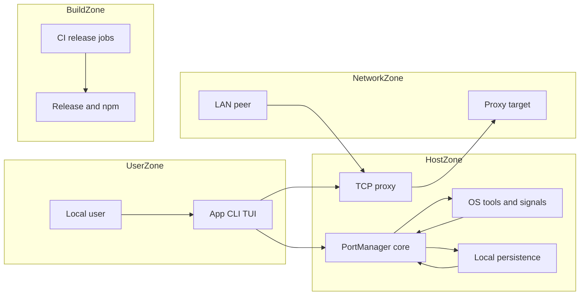

# PortPilot security assessment

## Executive summary

PortPilot is a user-session utility with unusually powerful local effects: it inventories processes and connections, sends signals, rewrites a user's crontab, controls Docker, launches cron commands, and can expose a raw TCP proxy. The assessment found two highest-priority defects: a documented blocklist form that never matched and a LAN-reachable proxy with no client authorization or resource bounds. It also found first-snapshot/name-only baseline evasion and fail-open discovery behavior. Those findings now have source-level remediations in this worktree, summarized below. No source evidence of embedded production credentials or direct shell injection through ordinary CLI arguments was found.

### Remediation status (source-level, 2026-10-22)

The finding sections below preserve the original evidence and attack paths. The approved fixes are now implemented in this worktree:

- TM-001: domain patterns are canonicalized; leading-dot, case, terminal-dot, and domain-boundary regressions were added.
- TM-002: proxies bind to loopback by default. LAN use requires explicit client CIDRs; admission limits, idle deadlines, port validation, and idempotent connection cleanup are enforced.
- TM-003: baseline identity uses user plus executable path (PID-scoped fallback), and new identities/remotes require two complete snapshots before promotion. Absolute findings surface on the first snapshot.
- TM-004: sensitive files are created/repaired as 0600, owned directories as 0700, arbitrary custom parent modes are preserved, and cron temp/history files use the same boundary.
- TM-005: checked subprocess calls reject launch failure, timeout, non-zero status, and truncated output; failed snapshots do not advance the baseline.
- TM-006: subprocess/cron output is bounded and reports truncation; manual cron runs have a one-hour maximum runtime and terminate the process tree on expiry.

Verification completed with automatic dependency resolution disabled: the macOS app and CLI Xcode builds pass, the canonical SwiftPM CLI target build passes, all 117 SwiftPM XCTest cases pass, `git diff --check` and project-file validation pass, and a local loopback relay harness passed admission, connection-cap, and idle-cleanup checks.

### Operator-guidance follow-up (2026-10-22)

- Security invariants and precautions are recorded in `AGENTS.md` and `mission.md`.
- A local, searchable 15-question FAQ is available in Settings and Security Center.
  App Quick Proxy warns about source-IP-only admission at its network opt-in.
- UI language distinguishes pending, paused, degraded, filtered-empty, and successful
  snapshots. “Flag host” replaces the misleading “Block host”; Reserved ports are
  correctly described as warnings, not kill prevention. Kill submission is not
  described as confirmed completion.
- Four pure monitoring-status regressions bring the suite to 121 passing tests.
  The macOS app builds successfully. FAQ disclosure, filtering, no-match recovery,
  and answer wrapping were exercised in an isolated static UI fixture, without
  starting the real monitor, Guard, cron jobs, or network listeners.
- This is source/regression and isolated-UI evidence, not installed/live acceptance
  or Windows parity. CIDRs are not authentication/encryption, broad CIDRs remain
  possible, cron Stop can affect independently launched matching processes, PID
  actions can target stale identities, and file permissions are not encryption.
  Existing firewall and endpoint protections should remain enabled.

### Three-agent remediation follow-up (2026-10-22)

The subsequent approved review addressed Guard discovery/lifecycle safety,
incarnation-bound process actions (app, CLI and TUI), errno-aware termination
receipts, cron transaction/duplicate/identity safety, shared alert-list locking,
independent remote recurrence, monitoring/notification truthfulness, Login Items
state and release-script failure propagation. Exact source paths, prerequisites,
reachability, impacts, confidence, safe regressions and residual limits for all
eleven findings are in [the follow-up report](docs/SECURITY_REVIEW_2026-10-22.md),
including final-audit discovery binding and failed-read mutation fixes. The
report also records the newly required signed-delivery policy gates.
The current shared suite passes 168 tests and mocked release wrappers pass 33;
the earlier 117/121-test counts above are historical checkpoints, not current totals.
The in-app FAQ now includes startup-status guidance and the remaining
check-to-signal, evolving-process-tree and external-crontab-editor race limits.
Build/test evidence still does not justify disabling endpoint protections.

## Scope and assumptions

- In scope: the current worktree, including modified and untracked files under `Sources/`, `Tests/`, `docs/`, release scripts, and GitHub Actions workflows.
- Runtime scope: macOS app, Swift CLI/TUI, shared `PortManagerLib`, local persistence, subprocesses, notifications, and the TCP proxy. Linux paths are included where implemented. Windows is treated as planned/partial because the repository advertises it but the package declares macOS as its only platform.
- Build scope: GitHub release and npm-publish workflows plus local signing scripts. No credentials, production systems, or third-party services were used. An attempted `swift test` contacted the public package host to fetch the declared ArgumentParser dependency and was immediately aborted; subsequent verification was offline-only.
- Deployment assumption: PortPilot runs as the logged-in user and must not require or encourage running the app/CLI as root. Installation may require elevation, but runtime should not.
- Network assumption: LAN proxy exposure is desired only as an explicit opt-in. LAN peers are not inherently trusted.
- Multi-user assumption: shared hosts are not confirmed as supported. Findings involving another local account are therefore conditional but still worth fixing cheaply.
- The worktree was already dirty before this assessment. Unrelated user changes were preserved; only the approved security paths, regressions, and this report were edited.

Resolved design decisions and remaining questions:

- LAN proxy access is explicit CIDR allowlisting; all private-address peers are not implicitly trusted.
- Will headless/server watch mode be promoted as a security monitor, or only as a developer diagnostic?
- Will shared Linux/macOS hosts become a supported deployment?

## System model

### Primary components

- macOS app: SwiftUI/AppKit UI, background connection/threat polling, notifications, port guarding, cron controls, and proxy controls (`Sources/PortPilot/`, especially `PortViewModel`, `MenuBarController`, and `Stores/`).
- CLI and TUI: local argument/key-driven discovery and process-control surfaces (`Sources/PortKillerCLI/`, `Sources/PortPilotTUI/`, `Sources/TerminalTUI/`).
- Shared core: OS discovery/parsing, signals, cron execution/control, Docker invocation, threat detection, persistence, and Network.framework proxy (`Sources/PortManagerLib/`).
- Local data: UserDefaults, Application Support cron history, `~/.portpilot/blocklist.txt`, and `~/.portpilot/threat-history.json`.
- Build/release: SwiftPM/Xcode, GitHub Actions artifacts/releases, npm publishing, and a local signing/notarization script.

### Data flows and trust boundaries

- Local user -> app/CLI/TUI: arguments, form values, keyboard actions, and notification actions cross the human-to-process boundary. The OS login session is the primary authentication boundary. Destructive notification kills require device authentication (`Sources/PortPilot/MenuBarController.swift:305-309`); most in-app/CLI actions rely on physical/session access.
- App/core -> OS tools: absolute-path subprocess invocations query `lsof`, `ss`, `ps`, `crontab`, `id`, `pgrep`, Docker, and SSH. Most arguments are passed as arrays rather than shell-concatenated strings (`Sources/PortManagerLib/PortManager.swift:1221-1229`). Cron "Run Now" intentionally executes the stored cron command through `/bin/sh -c` (`Sources/PortManagerLib/CronRunManager.swift:87-91`).
- OS output/files -> parsers and detector: process listings, socket tables, crontabs, blocklists, and persisted JSON cross from mutable local state into parsers. Validation is mostly structural parsing; malformed persistence generally decodes to empty state.
- Authorized LAN peer -> TCP proxy -> configured target: loopback is the default listener scope. Opt-in LAN listeners admit only configured client CIDRs and enforce connection/idle bounds before relaying raw TCP to the operator-selected target (`Sources/PortManagerLib/TCPProxyManager.swift`). This is network-source authorization, not cryptographic client authentication.
- Core -> local effects: signals can terminate/freeze processes; cron controls rewrite personal crontab; Docker actions stop/restart containers; proxy and SSH commands open network paths; stores write local history and blocklist files.
- Maintainer/GitHub -> release workflows -> GitHub/npm: tags trigger artifact releases and npm publication. Tokens are injected from GitHub secrets rather than stored in source (`.github/workflows/build.yml:87-125`, `.github/workflows/npm-publish.yml:25-36`). Local notarization sources an ignored env file and materializes the API key inside a `mktemp` directory (`scripts/release_signed_macos.sh:6-18,59-74`).

#### Diagram

## Assets and security objectives

| Asset | Why it matters | Security objective (C/I/A) |
|---|---|---|
| User processes and containers | PortPilot can terminate, freeze, stop, or restart them | I, A |
| Personal crontab and cron commands | Commands may be operationally critical and may contain sensitive arguments | C, I, A |
| Local service access through proxy | A loopback database/admin service may trust its source host | C, I |
| Connection/threat telemetry | Reveals usernames, processes, ports, and remote endpoints | C, I |
| Blocklist | Drives "critical" threat classification and incident response | I, A |
| Threat baseline and findings | Security conclusions depend on their identity and freshness | I, A |
| Release artifacts and npm package | Consumers trust published binaries/package contents | I, A |
| Signing/notarization and CI tokens | Compromise enables fraudulent releases | C, I |

## Attacker model

### Capabilities

- A LAN peer can connect to a host/port that the operator intentionally exposes and that host networking/firewall permits.
- A remote peer can influence connection volume and endpoints for a local service that accepts or initiates those connections.
- Malicious code already running as the same user can choose its executable name, connection cadence, stdout volume, and process lifetime.
- On a shared host, a different unprivileged account may read world-readable files but cannot normally signal or modify the victim user's processes/files.
- A malicious cron entry or compromised local project can provide commands/output later surfaced through PortPilot.

### Non-capabilities

- No assumption of root, kernel, TCC, sandbox, or code-signing bypass.
- No assumption that a remote internet attacker can directly operate the app UI or CLI.
- No assumption that a same-user attacker gains privilege merely by editing same-user configuration; such an attacker already has broad authority in that account.
- No production credentials, third-party accounts, or live external services are in scope.

## Entry points and attack surfaces

| Surface | How reached | Trust boundary | Notes | Evidence |
|---|---|---|---|---|
| CLI arguments | Local shell | User -> CLI | Includes kill/pause/resume, proxy, cron, connection watch, and blocklist commands | `Sources/PortKillerCLI/CLI.swift:102-1041`; `BlocklistCommand.swift:20-85` |
| TUI/App actions | Local session | User -> privileged local effects | Kill/freeze/cron/Docker/proxy actions execute as current user | `Sources/PortPilot/SecurityCenterView.swift:275-303`; `PortViewModel.swift:1011-1102` |
| Notification actions | macOS notification UI | Lock screen/session -> process kill | Kill action requires authentication | `Sources/PortPilot/MenuBarController.swift:305-309,373-393` |
| TCP proxy listener | Reachable TCP port | LAN -> host -> target | Raw unauthenticated relay, no source policy or connection bounds | `Sources/PortManagerLib/TCPProxyManager.swift:56-106,177-264` |
| OS command output | `lsof`, `ss`, `ps`, `netstat`, `tasklist`, Docker | Mutable OS state -> parser | Non-zero/timeouts are not consistently propagated | `PortManager.swift:1221-1293`; `PortManager+Connections.swift:39-64` |
| Cron command execution | App "Run Now" | Stored cron text -> shell | Intended shell execution; output collection is unbounded | `CronRunManager.swift:65-161` |
| Personal crontab rewrite | Pause/resume | App -> crontab | Temporary copy written under `/tmp` before chmod | `PortManager+CronControl.swift:35-93` |
| Blocklist file | CLI/UI/file edit | Local file -> detector | Leading-dot documented form fails to match | `BlocklistStore.swift:43-123`; `PortManager+Connections.swift:247-317` |
| Threat history | Background monitor | Connection metadata -> disk | Stores process/user/remote sample with default filesystem modes | `ThreatHistoryStore.swift:38-49,96-111`; `ThreatModels.swift:101-159` |
| Release workflows | Push tag/manual dispatch | GitHub actor -> release/npm | Narrow permissions and secret injection are present | `.github/workflows/build.yml:87-125`; `.github/workflows/npm-publish.yml:9-36` |

## Top abuse paths

1. Bypass a documented blocklist rule: operator adds `.evil.com` -> matcher compares against `..evil.com` suffix -> `cdn.evil.com` is not marked -> the critical blocklist signal never fires.
2. Reach a local-only service through PortPilot: operator starts LAN proxy to `localhost:5432` -> any reachable LAN peer connects to listener -> bytes relay without client authorization -> peer accesses the target under the host's network identity.
3. Exhaust the proxy: LAN peer opens many long-lived connections -> every pair is retained -> no cap or idle timeout closes them -> PortPilot and host descriptors/memory are exhausted.
4. Poison threat learning: malicious process is present at first tick or adopts a known process name -> baseline records name/remotes -> later behavior is no longer first-seen/new -> warning/info alerts are suppressed.
5. Blind the monitor: socket discovery fails/times out -> core returns partial/empty output or CLI replaces an error with `[]` -> the loop treats it as a valid snapshot -> current malicious activity is absent without a reliable degraded-state alert.
6. Crash the app through cron output: operator runs a compromised/noisy cron entry -> `/bin/sh -c` produces unbounded output -> `Data` grows until termination or memory exhaustion -> app availability is lost.
7. Read local security telemetry on a shared host: another account traverses a mode-0755 `.portpilot` directory and reads mode-0644 threat/blocklist files -> process names, usernames, remote endpoints, and response policy leak.

## Threat model table

| Threat ID | Threat source | Prerequisites | Threat action | Impact | Impacted assets | Existing controls (evidence) | Gaps | Recommended mitigations | Detection ideas | Likelihood | Impact severity | Priority |
|---|---|---|---|---|---|---|---|---|---|---|---|---|
| TM-001 | Remote endpoint using a documented blocked suffix | Operator follows documented `.suffix` syntax | Connect through a subdomain that the matcher fails to recognize | Critical blocklist signal is suppressed; response is delayed | Blocklist, findings | Boundary-aware suffix check for non-leading-dot patterns (`PortManager+Connections.swift:284-293`) | Leading dot is not normalized; no regression covers it | Normalize one leading dot and match exact base/subdomains; add direct tests | Warn on invalid/non-canonical entries; test every documented example | High | Medium | High |
| TM-002 | Untrusted LAN peer | Operator starts proxy and firewall permits LAN reachability | Use unauthenticated relay to reach target or hold many connections | Access to host-local services; proxy/host resource exhaustion | Target services, app availability | Operator chooses target; OS firewall may restrict reachability | No explicit exposure mode, client allowlist/auth, cap, or timeout | Default loopback; explicit LAN mode with selected interface/CIDRs, connection cap, idle timeout, and clear UI warning | Log remote peer, accepts/rejects, active count, and cap events | Medium | High | High |
| TM-003 | Same-user malicious process or pre-existing compromise | Code is running before/while monitor learns | Reuse trusted process name or stay below per-tick thresholds while baseline learns | Evades first-seen/new-remote signals; blocklist/count rules still operate | Threat baseline, findings | Blocklist, high-count, and fanout rules remain independent | Identity is only `processName`; first tick and every clean tick are trusted automatically; no decay | Key identity by executable path/signing identity plus user; quarantine first baseline; persist/approve trusted baseline; add decay | Surface baseline additions and identity changes; record suppressed candidates | Medium | Medium | Medium |
| TM-004 | Different local account on shared host | Victim uses default umask such as 022 | Read persisted telemetry or race-read temporary crontab copy | Process/remote policy disclosure; possible cron secret disclosure | Telemetry, blocklist, crontab | Cron temp file is eventually chmod 0600; signing temp dir uses `mktemp` | `.portpilot` defaults 0755, files 0644; cron chmod occurs after write | Create directories 0700; create files 0600 before content; use `mkstemp`/private temp directory; repair existing modes | Startup permission audit with one local warning | Low on single-user; Medium shared | Medium | Low now; Medium if shared supported |
| TM-005 | Fault/resource pressure affecting discovery | `lsof`/`ss` fails, exits non-zero, or exceeds timeout | Cause or coincide with discovery failure while malicious activity exists | Empty/partial snapshots look valid; alerts disappear or baseline changes | Monitoring availability/integrity | App has a failure counter, but only for thrown errors (`ThreatMonitorStore.swift:153-163`) | `runCommand` accepts non-zero/timeout; CLI watch uses `try? ... ?? []` | Throw typed errors on timeout/non-zero; never learn from failed snapshots; retain last-good assessment and expose degraded state | Log tool, status, timeout, duration, and consecutive failures | Medium operationally; Low attacker-induced | Medium | Medium |
| TM-006 | Noisy or compromised cron command; output-heavy subprocess | Operator invokes Run Now, or a queried tool emits large output | Stream unlimited stdout/stderr into in-memory `Data` | App/CLI memory exhaustion and crash | Availability | Pipe is drained to prevent child deadlock; general runner has a timeout | No byte cap; CronRunManager has no runtime cap; truncation happens only after collection | Cap retained output, discard excess with a flag, set max runtime, and terminate process tree | Log output truncation, runtime-limit termination, and peak bytes | Medium for accidents; Low deliberate | Medium | Medium |

### Evidence-backed findings

#### TM-001 — Leading-dot blocklist entries do not match subdomains

- Exact path: `PortManager.BlocklistEntry.matches` in `Sources/PortManagerLib/PortManager+Connections.swift:258-297`. The comparison uses `lowerHost.hasSuffix("." + lowerPattern)` at line 286. For `.evil.com`, that becomes the impossible suffix `..evil.com`.
- Contract evidence: `README.md:196-203`, `Sources/PortKillerCLI/BlocklistCommand.swift:46-50`, and `docs/THREAT_ENGINE.md:96-99` explicitly advertise `.evil.com`.
- Attacker prerequisites: control or use of a subdomain beneath a suffix the operator added with the documented leading-dot form.
- Reachable path: remote connection -> `getAllConnections` -> `isBlocklisted` -> `BlocklistEntry.matches` -> false -> `ThreatDetector.blocklistedSignal` sees no hit.
- Impact: the engine's only reputation-based critical signal is absent. This is detection bypass, not firewall bypass; PortPilot currently flags rather than blocks packets.
- Confidence: High. This follows directly from string construction, and existing tests cover only `evil.com`, not `.evil.com` (`Tests/PortPilotTests/BlocklistTests.swift:48-59`).
- Safe regression: add assertions that `.evil.com` matches both `evil.com:443` and hostname `cdn.evil.com`, while not matching `notevil.com`.
- Smallest correct remediation: canonicalize one optional leading dot at entry construction, reject an empty result, then use exact-base or `hasSuffix("." + canonicalDomain)` matching.

#### TM-002 — LAN proxy is an unauthenticated, unbounded relay

- Exact path: `TCPProxyManager.startProxy` and `handleNewConnection` in `Sources/PortManagerLib/TCPProxyManager.swift:56-106,177-224`; recursive relay and retained connection pairs at lines 226-286. User-controlled host/ports reach it through `ConfigurationPanel.ProxyCreateForm` at `Sources/PortPilot/ConfigurationPanel.swift:581-669`.
- Attacker prerequisites: network reachability to the chosen listen port while a proxy is active.
- Reachable path: LAN TCP connect -> `NWListener.newConnectionHandler` -> unconditional outbound `NWConnection` -> bidirectional byte relay.
- Impact: a peer can reach a target that may otherwise be loopback-only and can consume memory/file descriptors with long-lived connections.
- Confidence: High for missing authorization/resource controls; Medium for practical LAN reachability because host firewall/interface behavior is deployment-dependent.
- Safe local regression: start a proxy to a loopback-only fixture server, connect from an unapproved local address/client fixture, and assert rejection; separately open `limit + 1` loopback clients and assert the final client is closed without creating an outbound connection. No internet endpoint is needed.
- Smallest correct remediation: make loopback the default. Add an explicit LAN exposure mode with selected interface or allowed client CIDRs, inspect/reject the remote endpoint before creating outbound state, cap active connections, and enforce idle timeouts.

#### TM-003 — Threat baseline can be poisoned and identity-spoofed

- Exact path: baseline-relative rules are skipped until seeded (`Sources/PortManagerLib/ThreatDetector.swift:43-45,75-96`); identity and remotes are keyed only by `processName` and grow on every observation (`ThreatModels.swift:251-279`); the app and CLI silently learn first-tick data (`ThreatMonitorStore.swift:172-205`; `CLI.swift:978-1004`).
- Attacker prerequisites: malicious code already executing as the user, present on first start, or able to choose a trusted-looking executable name and connection cadence.
- Reachable path: malicious connection appears below independent thresholds -> monitor records its process name/remotes -> later snapshots treat that identity/remote set as known -> first-seen/new-remote rules do not fire.
- Impact: reduced detection coverage. It does not bypass explicit blocklist hits, high connection count, or fanout thresholds.
- Confidence: High for the state transition; Medium for severity because the feature may remain a developer heuristic rather than a security control.
- Safe regression: seed with `trusted-name` from executable identity A, assess the same name from identity B, and require an identity-change finding. Also verify first-run candidates are not promoted to trusted baseline without an explicit learning policy.
- Smallest correct remediation: extend baseline identity to executable path plus platform signing/hash metadata and user; distinguish candidate from trusted baseline; avoid automatic trust on first launch; add time-based decay or bounded learning.

#### TM-004 — Sensitive local files are created world-readable under common umask

- Exact path: `ThreatHistoryStore.persist` creates the directory/file without modes (`Sources/PortManagerLib/ThreatHistoryStore.swift:103-111`); the JSON includes user, process, PID, and remote sample (`ThreatModels.swift:101-159`). `BlocklistStore.writeLocked` does the same (`BlocklistStore.swift:116-123`). Cron pause/resume writes `/tmp/...` before chmod (`PortManager+CronControl.swift:74-83`).
- Attacker prerequisites: a separate local account on the same host and permission to traverse the relevant parent directories; cron race-read additionally needs timing.
- Reachable path: PortPilot records a finding or edits blocklist/crontab -> Foundation creates with umask-derived mode -> other local user reads file.
- Impact: disclosure of connection endpoints, usernames/processes, response policy, and potentially secrets embedded in a crontab command.
- Confidence: High for modes on the assessed macOS test environment. A local Foundation reproduction with umask 022 produced directory 0755 and both files 0644. Shared-host exposure remains an assumption.
- Safe regression: under a temp home and umask 022, write fabricated findings/blocklist content, then assert directory mode 0700 and file mode 0600. For crontab, inject a temporary-file factory and assert mode before any content write.
- Smallest correct remediation: create/repair `~/.portpilot` as 0700 and files as 0600; use `mkstemp` or a 0700 short private temp directory for crontab and write only after secure creation.

#### TM-005 — Connection discovery fails open

- Exact path: `PortManager.runCommand` returns output for timed-out and non-zero processes (`Sources/PortManagerLib/PortManager.swift:1283-1289`). The app only marks failures when `getAllConnections` throws (`ThreatMonitorStore.swift:153-163`). CLI watch collapses thrown errors to an empty snapshot (`Sources/PortKillerCLI/CLI.swift:983-1004`).
- Attacker prerequisites: ability to induce discovery failure/resource pressure, or an operational failure coinciding with malicious activity. Direct remote induction is an assumption, not established.
- Reachable path: tool error/timeout -> partial/empty output returned or error replaced by `[]` -> detector assesses it as valid -> monitor shows no current findings and may advance state.
- Impact: loss of monitoring integrity and availability precisely under load or host degradation.
- Confidence: High for fail-open error handling; Low-to-Medium for deliberate remote exploitability.
- Safe regression: invoke the internal runner on a local command that exits non-zero and another exceeding a millisecond timeout; assert typed errors. Inject a snapshot provider that throws and assert no baseline mutation, last-good findings retained, and degraded status surfaced.
- Smallest correct remediation: make launch failure, timeout, and non-zero status distinct errors; preserve stderr/status; never learn from failed snapshots; remove `try? ... ?? []` from watch mode.

#### TM-006 — Subprocess and cron output collection is unbounded

- Exact path: `CronRunManager.runNow` appends every pipe chunk to `collected` (`Sources/PortManagerLib/CronRunManager.swift:71-84`) and only truncates the rendered string after process exit (`117-141`). It has no runtime timeout. The shared runner likewise appends without a byte limit (`PortManager.swift:1244-1256`).
- Attacker prerequisites: operator runs a compromised/noisy cron entry, or a local/system tool emits attacker-amplified output.
- Reachable path: command writes continuously -> readability handler appends indefinitely -> process/app memory grows -> crash or forced termination.
- Impact: local denial of service and loss of monitoring/controls.
- Confidence: High for the unbounded sink; Medium for attacker reachability because cron execution is an explicit user action.
- Safe regression: run a local fixture emitting more than the configured cap and assert retained output never exceeds the cap, truncation is reported, and a runtime deadline terminates the process tree. Do not use an infinite producer in CI.
- Smallest correct remediation: retain only a bounded prefix/ring, count discarded bytes, add an execution deadline, and reuse the existing process-tree stop logic on timeout.

## Criticality calibration

- Critical: pre-auth remote code execution in PortPilot; arbitrary root/system process control; compromise of signing/notarization/npm credentials leading to trusted malicious releases.
- High: unauthenticated LAN access to loopback-only databases/admin services; reliable cross-user process control; silent failure of a primary security control with realistic remote prerequisites.
- Medium: evasion or fail-open behavior in the threat monitor; user-triggered memory exhaustion; disclosure of sensitive operational metadata on supported shared hosts.
- Low: single-user-only metadata leakage, short-lived stale UI state, or hardening gaps requiring same-user authority that already permits the direct action.

Examples in this assessment:

- Critical examples (not observed): signing-key theft, root-level arbitrary kill, or pre-auth RCE in the TCP listener.
- High examples: TM-002 when proxying a sensitive loopback service; TM-001 is high priority because it defeats the documented critical-signal control and is trivial to trigger/fix.
- Medium examples: TM-003, TM-005, and TM-006; TM-004 if shared hosts become supported.
- Low examples: TM-004 under the current single-user assumption; transient 60-second blocklist cache staleness after edits.

## Focus paths for security review

| Path | Why it matters | Related Threat IDs |
|---|---|---|
| `Sources/PortManagerLib/TCPProxyManager.swift` | Only remotely reachable runtime surface; owns relay lifetime and policy | TM-002 |
| `Sources/PortPilot/ConfigurationPanel.swift` | Defines proxy exposure UX and accepted target/listen values | TM-002 |
| `Sources/PortManagerLib/PortManager+Connections.swift` | Parses security telemetry and implements blocklist semantics | TM-001, TM-005 |
| `Sources/PortManagerLib/BlocklistStore.swift` | Persists incident-response policy and needs secure modes/coordination | TM-001, TM-004 |
| `Sources/PortManagerLib/ThreatDetector.swift` | Central detection rules and baseline comparisons | TM-001, TM-003 |
| `Sources/PortManagerLib/ThreatModels.swift` | Defines baseline identity and persisted sensitive fields | TM-003, TM-004 |
| `Sources/PortPilot/Stores/ThreatMonitorStore.swift` | Decides failure, learning, cooldown, persistence, and alert semantics | TM-003, TM-005 |
| `Sources/PortKillerCLI/CLI.swift` | Headless watch currently converts discovery errors into empty snapshots | TM-003, TM-005 |
| `Sources/PortManagerLib/PortManager.swift` | Shared subprocess and process-signal choke point | TM-005, TM-006 |
| `Sources/PortManagerLib/CronRunManager.swift` | Intentional shell execution, output retention, and process-tree control | TM-006 |
| `Sources/PortManagerLib/PortManager+CronControl.swift` | Rewrites crontab through a temporary copy | TM-004 |
| `Sources/PortManagerLib/ThreatHistoryStore.swift` | Stores endpoint/process evidence on disk | TM-004 |
| `Sources/PortPilot/SecurityCenterView.swift` | Turns heuristic findings into destructive PID actions | TM-003 |
| `.github/workflows/` | Release authority and secret-bearing jobs | Supply-chain review |
| `scripts/release_signed_macos.sh` | Local signing/notarization credential boundary | Supply-chain review |

Quality check:

- Covered discovered app, CLI, TUI, notification, subprocess, persistence, proxy, cron, Docker, and release entry points.
- Represented each runtime trust boundary in the model and abuse paths.
- Kept runtime findings separate from CI/release hardening.
- Reflected clarified root, LAN, and multi-user assumptions.
- Distinguished confirmed code behavior from conditional reachability and deployment assumptions.
- No scanner output was treated as a vulnerability, and no fixes were implemented.
